# PiNVR Secure View

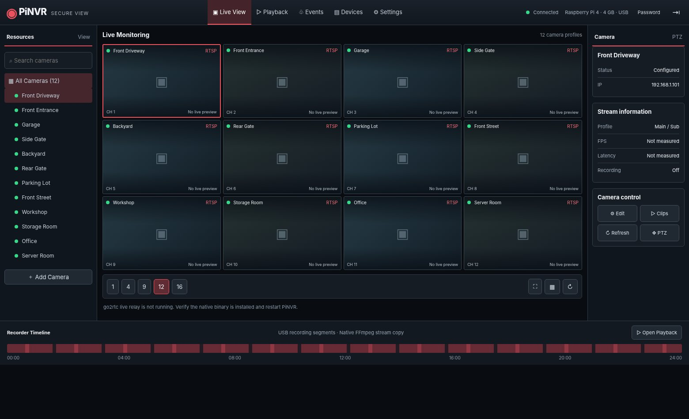

**Native Raspberry Pi NVR + iPhone/Android mobile web app**, styled as a dark professional security console. Designed initially for Raspberry Pi 4 (4 GB RAM), 9+ RTSP cameras and external USB recording storage. **No Docker.**

> **Development status: early working alpha.** Login, recurring password-change recommendation, RTSP camera configuration, FFmpeg stream-copy recording to mounted USB storage, recorded MP4/MKV listing, JPG snapshots and browser playback, and responsive PWA UI are implemented. WebRTC live streaming is now wired through go2rtc but requires live camera and Raspberry Pi testing. ONVIF discovery and authenticated motion-event webhooks are implemented. ONVIF motion-event subscriptions, PTZ, mobile push notifications, and measured latency/FPS **still require implementation or on-device testing**. Do not replace a production NVR until tested on your camera hardware.

## Screenshots & how to use

| Screen | Preview | What it does |
| --- | --- | --- |
| Desktop Live View |  | Camera tree, layout choices (1/4/9/12/16), focus selected camera, recording status. WebRTC streams activate for up to four visible cameras at a time; clicking Focus loads the selected main stream. The documentation screenshots use example cameras and placeholders. |
| Camera Management | 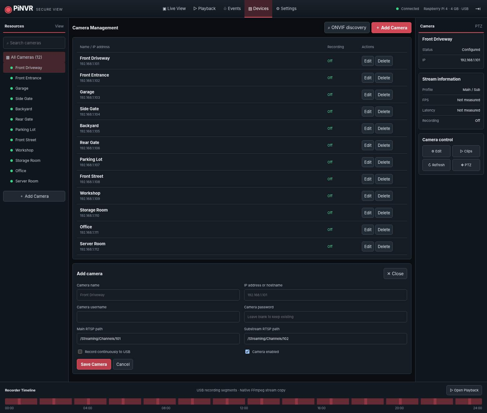 | Add, edit and remove RTSP IP cameras; specify main/substream RTSP paths and enable recording. |
| Playback | 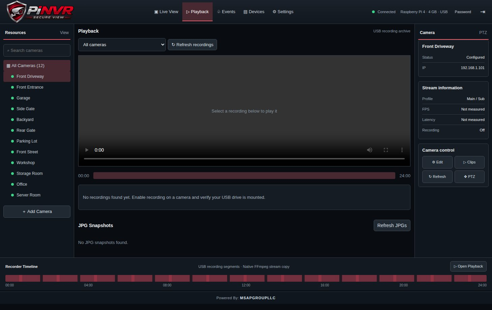 | Search MP4/MKV segments and JPG snapshots by camera. MP4 playback works with supported browser codecs; MKV is offered as a download. Requires mounted storage. |
| Recording formats and JPG settings | 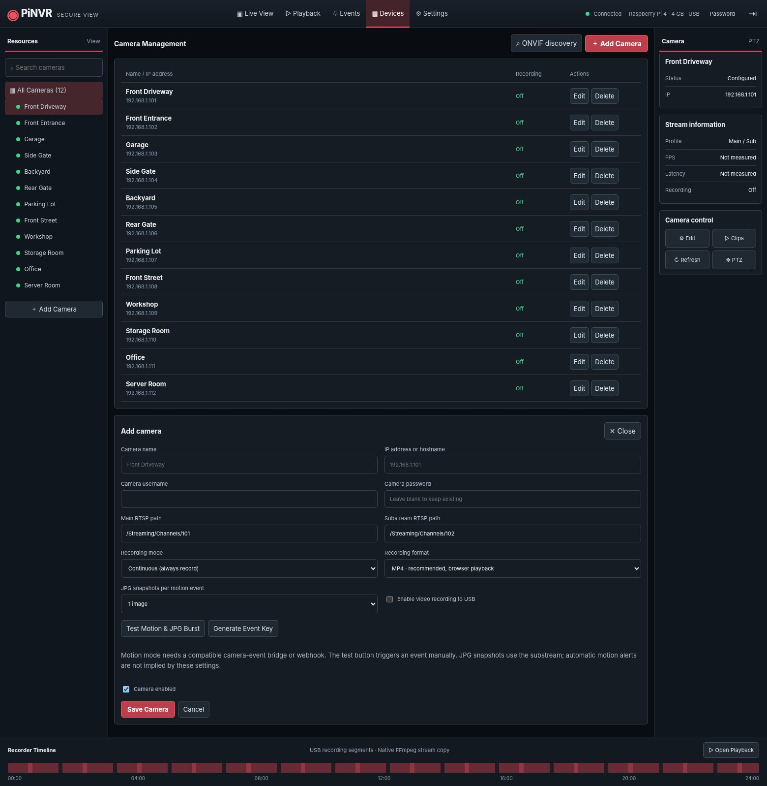 | Set continuous or motion-triggered recording, choose MP4/MKV, set 1–7 JPG snapshots per event, and test motion. |
| Native video motion detection | 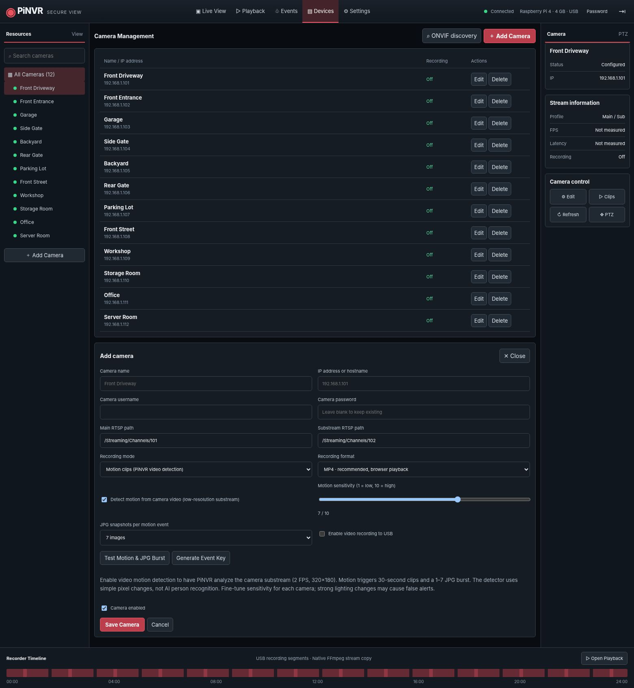 | Enable built-in motion detection from RTSP substreams, set per-camera sensitivity, and use motion-triggered clips and 1–7 JPG snapshots. Detection requires real compatible camera substreams and sufficient Pi CPU capacity. |
| Admin Users & Permissions | 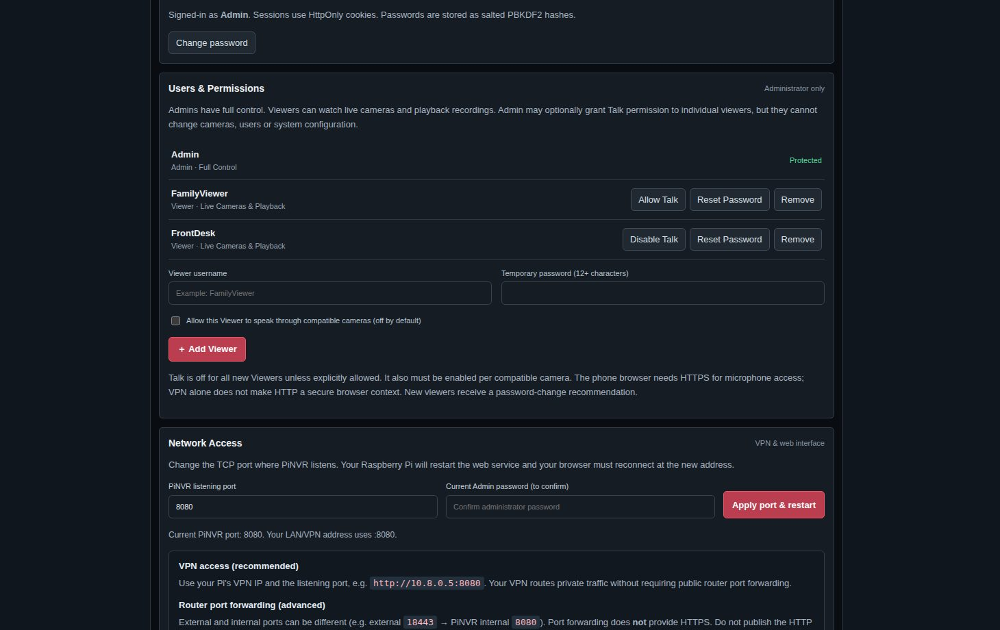 | Create or remove Viewer accounts, reset Viewer passwords and see access restrictions. |
| Viewer Mobile | 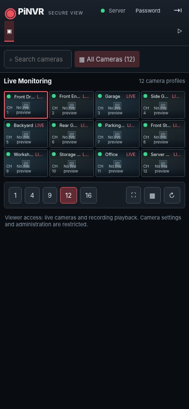 | Viewer can open Live View and Playback without accessing Admin settings. |
| Mobile Admin — Live View |  | Phone-first default 4-camera grid, quick camera search, large layout/focus buttons and labeled bottom navigation. |
| Mobile Admin — Playback | 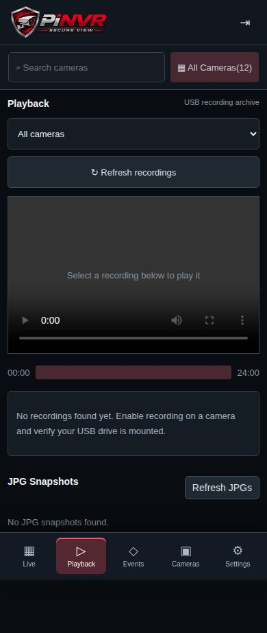 | Mobile player, camera selector, recordings and JPG gallery. |
| Mobile Admin — Camera Setup | 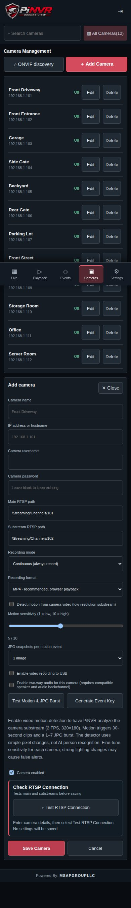 | Single-column camera setup with touch-sized recording and motion options. |
| Mobile Viewer — Live View | 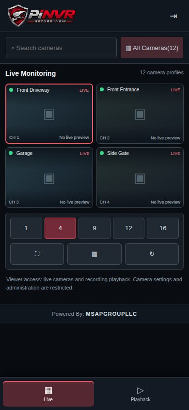 | Live cameras with Viewer-only navigation; no Admin menus. |
| Mobile Viewer — Playback | 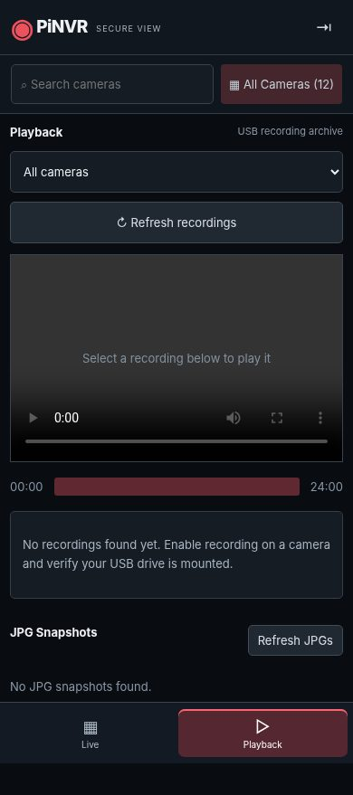 | Viewer can find and play permitted recordings and JPG snapshots from a phone. |
| Mobile — Sign In | 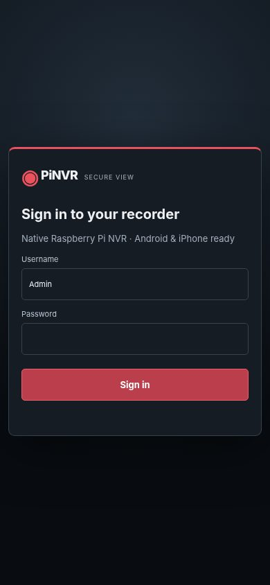 | Full-width touch-friendly sign-in form. |
| Mobile (earlier desktop-responsive view) | 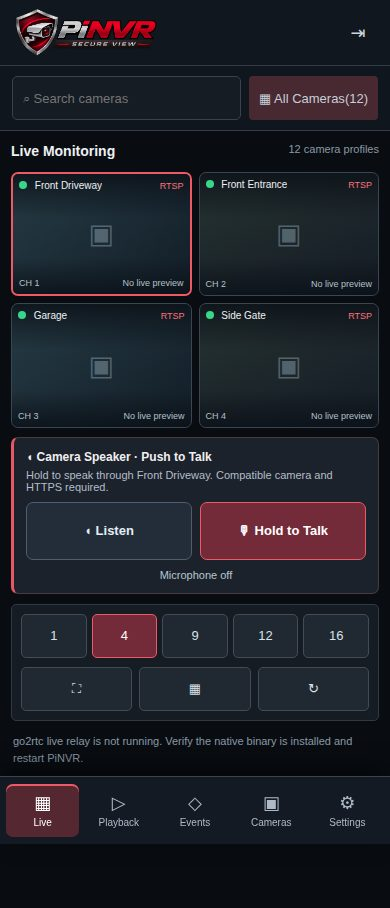 | Open the same server on Android Chrome or iPhone Safari and add to home screen; mobile interface shares server settings. |
| USB Storage Setup | 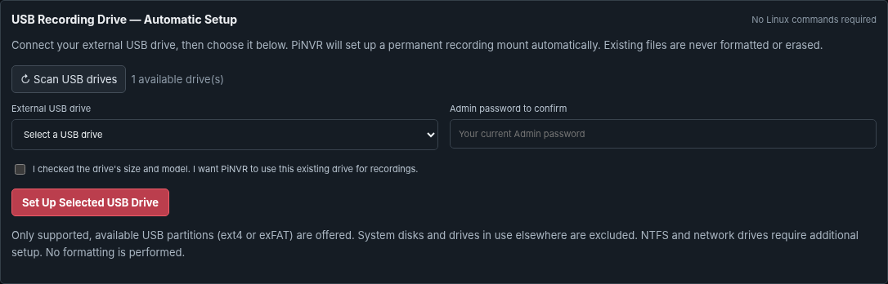 | Admin scans supported external USB drives, chooses one and confirms; PiNVR mounts it and makes the mount persistent without Linux commands or formatting. |
| Network Access | 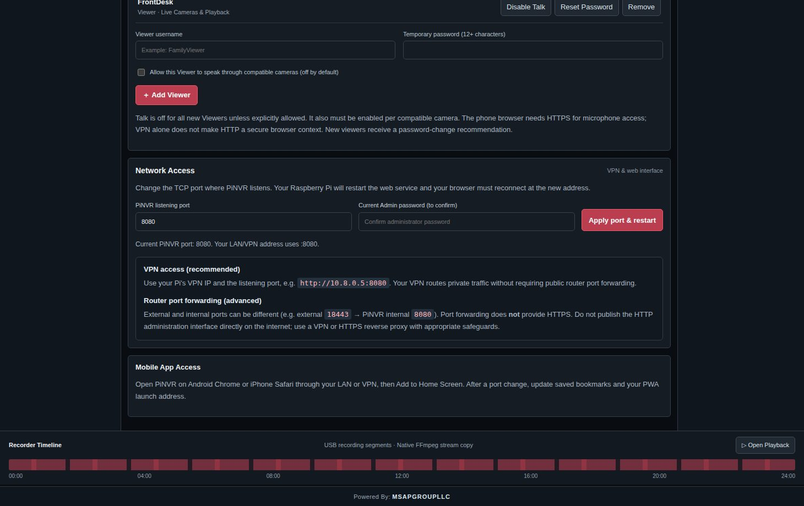 | Change the web listening port, view VPN guidance and understand router external-to-internal mappings. |
| Login | 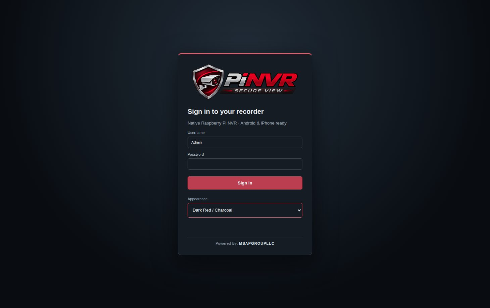 | Sign in as Admin or Viewer. A dismissible security reminder appears on each login until the password is changed. |

Screenshots are from an application test run using example camera definitions. No footage or performance measurements are claimed.

## Start here — beginner-friendly Raspberry Pi setup

**New to Linux? You can follow this guide one command at a time.** You do not need Docker or previous Linux experience. The steps below assume your Raspberry Pi already has **Raspberry Pi OS Lite (64-bit)** installed, is connected to your home network, and has internet access.

### What you'll need

- Raspberry Pi 4 (4 GB RAM recommended), its power supply, and a microSD card running Raspberry Pi OS Lite (64-bit).
- A wired network connection (recommended), your RTSP/IP cameras, and an external USB drive **for recordings**.
- Another computer or a keyboard/monitor connected to the Pi.
- Your Pi's Linux username and password. These are **not** the PiNVR `Admin` / `raspberry` login.

### How to enter commands

You will type commands into a **Terminal**, which is a text-based window for controlling your Pi.

- **Using a monitor/keyboard on the Pi:** Sign in to Raspberry Pi OS. You will see a command prompt.
- **Using another computer:** Enable SSH in Raspberry Pi Imager when preparing the microSD card, then open Terminal on Mac/Linux or PowerShell on Windows and connect with `ssh YOUR_PI_USERNAME@YOUR_PI_IP` (for example `ssh alex@192.168.1.50`). Accept the host key **only if you recognize your Pi**, then enter your Pi's Linux password. The characters may not appear as you type; that is normal.
- Copy **one command block at a time**, paste it, press **Enter**, and wait for the prompt to return before continuing.
- `sudo` means “run as administrator.” If prompted, enter the **Pi's Linux user password**, not the PiNVR app password. Password typing may be invisible.
- Text shown as `YOUR_...` is a placeholder you **must replace** with your real value. Do not type angle brackets from examples.

### Step 1 — Update the Pi and get PiNVR

Run:

```bash
sudo apt update
sudo apt upgrade -y
sudo apt install -y git
git clone https://github.com/msapgroup/PINVR.git
cd PINVR
```

The `cd PINVR` command moves into the downloaded folder. If the clone says that the `PINVR` folder already exists, **don't delete it**; run `cd PINVR` and use `git pull --ff-only` to update the existing checkout (after saving any local changes).

### Step 2 — Install the application (no Docker)

```bash
sudo bash install.sh
```

The installer configures the native PiNVR service, FFmpeg, and go2rtc. Wait for it to finish and check for errors. To check whether the service started:

```bash
sudo systemctl status pinvr --no-pager
```

You want to see **active (running)**. If it fails, use `sudo journalctl -u pinvr -n 50 --no-pager` to see errors. A camera connection is not needed to complete installation.

### Step 3 — Set up your USB recording drive

After installing PiNVR, open its **Admin Settings → USB Recording Drive — Automatic Setup** screen. Plug in your external drive, click **Scan USB drives**, select it, and confirm. The app does the Linux drive setup for you. Instructions and a screenshot are below. PiNVR will not record to an unmounted system microSD card.

### Step 4 — Open PiNVR in your web browser

On the Raspberry Pi, run:

```bash
hostname -I
```

Find its local network IP address, for example `192.168.1.50`. On a device connected to the same network, open **`http://192.168.1.50:8080`** (replace the example IP with yours).

Sign in using:

| Setting | Initial value |
| --- | --- |
| PiNVR username | `Admin` |
| PiNVR password | `raspberry` |
| Default web port | `8080` |

PiNVR recommends changing this **publicly known default password** each time you sign in until you change it. The reminder can be dismissed for that login. **Change the password before allowing anyone else to access your NVR, even over VPN.**

Next, use **Devices → Add Camera**, enter a camera's IP address and RTSP connection details, and test **one camera first** before configuring all 9+ cameras. Check **Settings → Storage / System Health** to confirm the USB drive is mounted.

**Remote access:** Use your existing VPN and the Pi's reachable VPN IP and web port. The web port can be changed under **Settings → Network Access**. **Do not forward the PiNVR HTTP or go2rtc streaming ports directly to the public internet.** Use HTTPS for access over networks you do not fully trust.

### Common Linux words, explained

| Term | What it means |
| --- | --- |
| Terminal | The place where you type commands. |
| SSH | A secure way to open the Pi's Terminal from another computer. |
| `sudo` | Run a command with administrator privileges. |
| USB *mount* | Make the external drive available at a folder (PiNVR uses `/mnt/pinvr-recordings`). |
| UUID | The unique identifier of a drive partition; safer than guessing `/dev/sda1`. |
| Filesystem | How the drive stores files, for example ext4, exFAT, or NTFS. |
| `/etc/fstab` | A configuration file Linux reads to reconnect drives when it starts. |
| `nano` | A simple terminal-based text editor. |
| `systemctl` | Starts, stops, and checks background services such as PiNVR. |

### Set up your USB recording drive — inside PiNVR (no Linux commands)


PiNVR can prepare your external USB drive for recordings right from the **Admin dashboard**. You do **not** need to edit `/etc/fstab`, find a UUID, mount a drive manually, or run Terminal commands for storage. The setup also remembers the drive after a restart.

1. **Plug in your external USB recording drive** to a USB 3.0 port on the Raspberry Pi.
2. On a computer or phone connected to your network or VPN, sign in to PiNVR as **Admin**.
3. Open **Settings → USB Recording Drive — Automatic Setup**.
4. Select **Scan USB drives**. The list shows supported external USB drives along with their **name, size, and filesystem**.
5. **Check the drive's name and size carefully** so you do not choose the wrong drive. Choose the drive that you want to use for your camera recordings.
6. Enter your current **PiNVR Admin password**, tick the confirmation checkbox, then select **Set Up Selected USB Drive**.
7. When PiNVR reports that the drive is ready, check **Settings → System Health** to confirm it is mounted. You can now open **Devices**, select one camera, enable recording, and check **Playback** after a clip has been saved.

**What the app does for you:** It checks the available USB partitions, excludes the Raspberry Pi system drive and drives currently used elsewhere, makes a backup of Linux's mount configuration, mounts the chosen drive at `/mnt/pinvr-recordings`, checks write access, and sets it to reconnect on reboot. **It does not format, partition, or erase your drive.**

**Supported for automatic setup:** Available **ext4** and **exFAT** USB partitions. NTFS drives, busy drives, network storage and other filesystems are not auto-configured in this version. If your drive is missing from the list, **do not format it**. Check that it is plugged in, powered on, and not already in use at another mount point, or ask for help.

**Important:** If your drive already has files, check that you have a backup before making storage configuration changes. Storage settings are **Admin-only**. Viewer accounts cannot change recording drives.

### Quick troubleshooting if the drive is not found

- Make sure the USB cable and power supply are working. Try a USB 3.0 port (blue connector) on the Pi 4.
- Select **Scan USB drives** again. If the list stays empty, the drive may use an unsupported filesystem or already be mounted elsewhere.
- Do not unplug a recording drive while it is saving video.
- If PiNVR shows a setup error, **leave the drive untouched** and review the error or ask for help. The app does not attempt to reformat or wipe it.
- After a successful setup, reboot the Pi at a convenient time and check that the Storage status still says the drive is mounted.

### Add a camera

1. Open **Devices → Add Camera**.
2. Enter a name, IP/hostname and camera username/password.
3. Provide main and substream paths (e.g., `/Streaming/Channels/101` and `/Streaming/Channels/102` for compatible camera models; paths vary by manufacturer).
4. Select **Enable video recording to USB**, choose **Continuous** or **Motion event clips**, select **MP4** (recommended) or **MKV**, and choose **1–7 JPGs per motion event**. Save. For motion mode, configure an external camera-event integration as described below.
5. Verify **Settings → Recording workers** is active and inspect `journalctl -u pinvr` if not.
6. Select **Playback** to see completed 5-minute continuous recording segments or 30-second motion-event clips (when an event is received). The JPG gallery displays available snapshots.

Recording uses `ffmpeg -c:v copy` without decoding to reduce Pi load. **MP4 with fragmented metadata is the default:** it is easier to view on iPhone, Android, and most browsers when the camera uses H.264, and has better interruption recovery than ordinary non-fragmented MP4. **MKV** is an alternative for resilient storage and VLC playback but generally downloads rather than playing natively in browsers. Neither container converts unsupported codecs; use camera-native H.264 where practical. <https://ffmpeg.org/ffmpeg-formats.html> Segment boundaries depend on keyframes, so durations may vary. The supervisor retries stopped recorder processes every 15 seconds. Disk retention management is **not implemented yet**: monitor free space to avoid exhaustion.


### Motion recording, JPG bursts and ONVIF discovery


**Native video motion detection:** For each camera, enable Detect Motion from Video. PiNVR compares 320×180 grayscale substream frames sampled at approximately 2 FPS and triggers a motion event when changes exceed the selected 1–10 sensitivity. Start with sensitivity 5; adjust to reduce false positives from trees, headlights, or sudden lighting changes. This requires active camera RTSP access, uses CPU for decoding each enabled substream, and has not yet been benchmarked with 9+ simultaneous cameras on a Raspberry Pi 4. Do not enable motion processing on all cameras until measured resource usage is acceptable.


- **Continuous (default):** direct-copy five-minute MP4 or MKV segments for every recording-enabled camera. For a Pi 4 with 9+ cameras this is the simplest, most reliable starting choice.
- **Motion events:** short **30-second** direct-copy video clips and a **1–7 image JPG burst** captured from the camera's substream at approximately 1 image/second, when an authenticated event arrives. This does not provide pre-event buffering, and hardware/stream timing may affect the precise recorded duration. A motion clip requires **Enable video recording**; JPG bursts can be created without a motion video clip.
- **Test Motion & JPG Burst:** press in the camera editor for a saved camera. JPG generation requires the USB drive, camera RTSP connectivity, and FFmpeg; with no physical cameras connected it will not create images.
- **ONVIF Discovery:** Devices → ONVIF discovery performs a local UDP WS-Discovery search. It lists candidate camera IPs and service addresses but does not automatically authenticate or configure every vendor's RTSP path.
- **Motion webhook:** Admins can select **Generate Event Key** in a saved camera's editor. The key is displayed once and must be stored securely. A compatible camera notification bridge sends `POST http://PI-VPN-IP:PORT/api/events/motion/CAMERA_ID` with header `X-PiNVR-Event-Key: GENERATED_KEY`. The camera is recorded as a motion event and can trigger the configured JPG burst and motion clip. **This is an integration interface—not a universal ONVIF motion detector.** Camera-native ONVIF event subscription/pull-point support is still planned. Do not publish this endpoint directly to the public internet; use your VPN and protect the secret.
- **Storage:** snapshots live under `/mnt/pinvr-recordings/CAMERA_ID/snapshots` as JPG files. Playback lists both stored clips and snapshots, with Viewer read-only access to enabled camera recordings. Viewer accounts cannot manually trigger captures or generate webhook credentials.

A recording format change affects **new files**; previously recorded MP4/MKV files are preserved. Set the right time and timezone on the Raspberry Pi for reliable date-based filenames.

### Change the web access port (VPN / advanced router setups)


1. Sign in as `Admin` and optionally dismiss the recurring password-change recommendation.
2. Open **Settings → Network Access**. The default TCP web port is **8080**.
3. Enter a new unused port from **1024 to 65535** (excluding **1984** and **8555**, which PiNVR reserves for internal streaming) and your **current Admin password**.
4. Select **Apply port & restart**, confirm, and open the new URL shown by PiNVR, for example `http://192.168.1.50:8090`. The native systemd service automatically restarts and preserves this setting across reboots and upgrades. If the new port cannot be bound during restart, the launcher attempts to recover on the previous port.
5. Update any VPN firewall policy, saved mobile app shortcut, reverse proxy, or router mapping to match the new listening port. Keep private VPN access as the recommended option.

**Port mapping distinction:** Your **PiNVR listening port** and your **router external port** are separate. A router could map external `18443` to an internal PiNVR port `8080` without changing PiNVR at all. Port forwarding provides **no encryption**, and the alpha web application speaks HTTP; **do not expose it directly to the internet**. Use your existing VPN or configure a secure HTTPS reverse proxy before sharing remotely. An external HTTPS proxy typically terminates TLS at its own port and forwards to PiNVR privately.

**Troubleshooting:** If you cannot reconnect after a port change, connect over SSH/VPN and run `sudo systemctl status pinvr` and `sudo journalctl -u pinvr -n 100`. You can inspect the configured port with `sudo sqlite3 /var/lib/pinvr/pinvr.db "SELECT value FROM settings WHERE key='web_port';"` if `sqlite3` is installed. The Pi firewall must permit the chosen port on the LAN/VPN interface. Avoid changing the port while remotely accessing PiNVR without a fallback SSH path. A port change does not alter the go2rtc WebRTC media port `8555`, which needs private/VPN connectivity when live video is used.

### Accounts, password reminders and Viewer playback


- **Admin:** Full camera, recording, network, user, and system control.
- **Viewer:** Live camera feeds **and recorded clip search/playback** on both desktop and mobile. Cannot add/edit/delete cameras, change recording policies, use admin system APIs, or administer accounts.
- The default `Admin` / `raspberry` password remains usable until changed, but because it is public, the system shows a **security recommendation at every login** until a stronger password is set. Select **Remind me next login** to dismiss it for the current session, or **Change password**. Viewer accounts with newly assigned passwords receive the same reminder. The reminder does not block playback or configuration.
- For remote VPN access, use unique passwords and restrict network access. Allowing the public default password to remain active increases risk, even over a VPN.


### Android and iPhone — browser and home-screen access

PiNVR works in mobile Safari on iPhone and Chrome on Android. On the phone, connect to your **same private Wi-Fi or VPN**, then open the PiNVR web address such as `http://192.168.1.50:8080` (use your actual Pi IP and configured port).

1. **Sign in:** Admin and Viewer accounts use the same sign-in screen. A recommended password-change reminder is optional, not a login blocker.
2. **Live:** Phones start with a **four-camera grid** for readable video tiles. Tap a camera, then **Focus** to see one larger feed. Use **1 / 4 / 9 / 12 / 16** to change how many cameras are shown. The player prioritizes up to four simultaneous preview streams to reduce Raspberry Pi load; additional tiles do not all decode at once.
3. **Bottom navigation:** Use the clearly labeled bottom tabs to switch sections. **Viewers get Live and Playback only**. Admins also see Events, Cameras, and Settings.
4. **Playback:** Open **Playback**, select a camera, and choose a recorded MP4. Compatible H.264 recordings play directly. MKV files may require a separate player. JPG motion-event images appear below the recordings.
5. **Admin setup:** Use **Cameras** to add or edit a camera and **Settings** to set up USB storage, users, and VPN listening port. Forms are stacked and scroll vertically on a phone.
6. **Home screen shortcut:** In Safari, choose **Share → Add to Home Screen**; in Chrome, open the browser menu and choose **Add to Home screen / Install app** (wording varies). This is a responsive web app, not a separately released App Store or Play Store application.

**VPN note:** If PiNVR uses HTTP on a private VPN, some browser install/PWA capabilities, including push and persistent service workers, may need HTTPS. Video also requires the private network to reach go2rtc's WebRTC media port (8555). **Do not forward PiNVR or go2rtc ports directly to the public internet.** Do not promise video while the phone is disconnected from the VPN.

#### Mobile quality checks

To reproduce mobile viewport checks and screenshots on a developer machine with Playwright/Chromium installed:

```bash
python tests/mobile_smoke.py
```

The test checks phone widths **360, 390 and 430 pixels**, verifies no horizontal overflow, confirms the 4-camera/two-column starting layout, tests bottom navigation, and checks the Viewer's restricted navigation. Screenshots show example camera profiles and placeholders, **not live footage**. Raspberry Pi hardware tests and browser/codec validation on real phones are still required.


## Architecture

- **FastAPI + SQLite** — authenticated configuration, clip listing and status API.
- **FFmpeg** — one `-c:v copy` worker per enabled continuous-recording camera; event-triggered clip and JPG workers only when a webhook or manual test triggers them.
- **go2rtc v1.9.15** — native ARM64 video relay with authenticated WHEP signaling from PiNVR to loopback go2rtc, and direct WebRTC media on port 8555.
- **USB mount safety** — block writes if the recording mount is absent.
- **Responsive HTML/CSS/JavaScript** — dark Hikvision-inspired PiNVR UI (independent branding) for desktop/mobile.
- **systemd** — native service, runs unprivileged as `pinvr`.

**Security caveats for this alpha:** HTTP on LAN is not encrypted; configure TLS before transmitting camera credentials on untrusted networks. Camera passwords are stored in a restricted SQLite file, **not encrypted at rest**. A logged-in local admin can inspect process arguments containing camera RTSP credentials; isolate the Pi and restrict system accounts. Auth currently supports one built-in admin and multiple Viewer accounts, but has no login rate limiting or CSRF token mechanism. Viewer accounts can access live streams and recordings, not administrative endpoints. Do not publicly expose the service. Treat this as an early integration/test build.

## Local development & tests

```bash
python3 -m venv .venv && . .venv/bin/activate
pip install -r requirements.txt pytest
PINVR_DATA=/tmp/pinvr-dev PINVR_RECORDINGS=/tmp/pinvr-clips uvicorn pinvr.main:app --port 8080
pytest -q
```

The app can run locally without the go2rtc binary for camera management and recordings; live feeds require the binary. The default app refuses recording to an unmounted directory. `PINVR_ALLOW_LOCAL_RECORDINGS=1` is **test-only** and bypasses mount detection; never set it for a real deployment.

## Roadmap

1. Test and tune the new go2rtc WebRTC bridge, low-latency substreams and authentication on a physical Raspberry Pi 4 with 9–16 cameras. Add stream health/reconnect diagnostics and optimized camera-wall subscription.
2. Extend basic ONVIF discovery to camera provisioning, PTZ and automatic ONVIF camera-native motion event subscriptions (webhook support is already available).
3. Disk usage limits, retention cleanup and failed-disk alerts.
4. Multi-user accounts, encrypted camera secrets, login rate limiting, CSRF protections and HTTPS deployment.
5. Benchmark 9/12/16 active streams and publish real FPS, latency, temperature and storage throughput results.

## License

See [LICENSE](LICENSE) in this repository.
